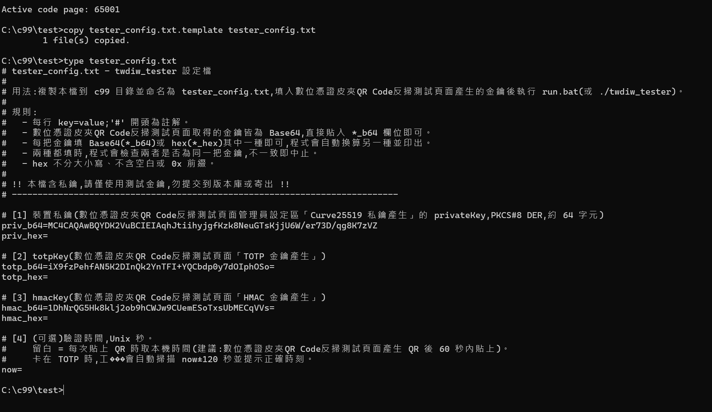
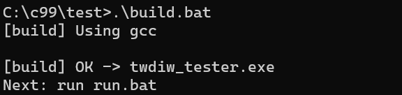
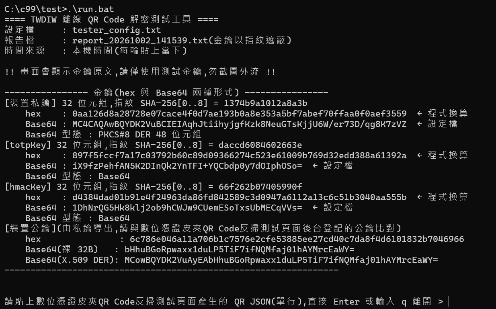
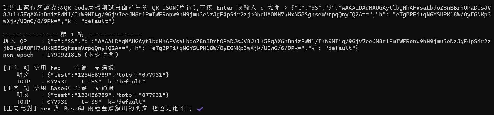
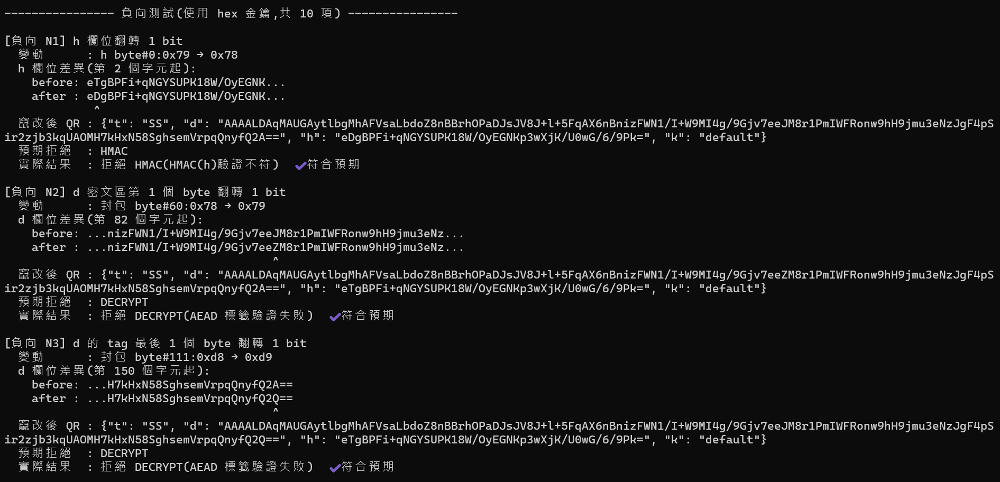
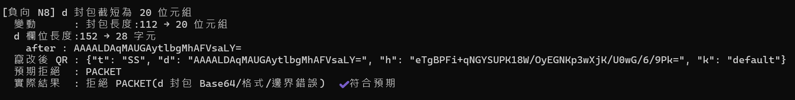
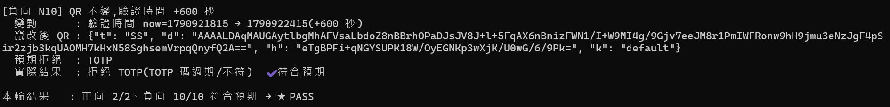
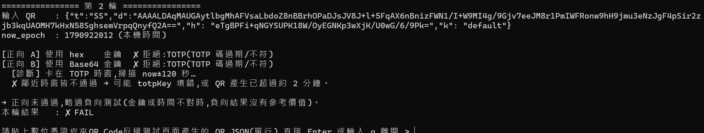

# 門禁讀卡機解密範例實作

這個目錄是離線 QR Code 驗證的 C99 參考實作，提供給驗證端設備廠商使用。內容分成兩部分，依嵌入式開發「先在電腦上測、再上硬體」的順序進行：

- **[第一部分：主機端測試](#第一部分主機端測試)**：在開發用電腦（主機端，host）上，用驗證核心 build 測試工具，貼上[數位憑證皮夾QR Code反掃測試頁面](#數位憑證皮夾qr-code反掃測試頁面)產生的密文（加密後 JSON），確認程式能正確解密，竄改過的密文也都會被擋下。測試結果是第二部分的比對基準。
- **[第二部分：設備移植與實機測試](#第二部分設備移植與實機測試)**：把同一份驗證核心移植到自己的設備上，說明要改哪些函式、為什麼改、怎麼改，以及改完後如何 build、匯入金鑰和測試。實機上用同樣的金鑰和 QR Code，結果應和第一部分一致。

請先完成第一部分。第一部分全部通過，代表程式和金鑰都沒有問題；之後實機若出錯，就能把範圍縮小到移植時調整的部分（時間來源、金鑰存放、掃描輸入）。

## 目錄結構

```
c99/
├── src/                        驗證核心（移植到設備的就是這份程式碼）
│   ├── twdiw_verify.c/.h       驗證流程：解析 → 解密 → TOTP → HMAC
│   ├── twdiw_platform.c/.h     平台層：時間與金鑰（架構 B 要改寫）
│   └── lib/                    核心用到的基礎函式庫
│       ├── qr_parse.c/.h       QR Code JSON 解析
│       ├── ecc_service.c/.h    ECDH + ChaCha20-Poly1305 解密
│       ├── totp.c/.h           TOTP 計算與預設時間來源
│       └── ...                 密碼學基礎函式（SHA-256、X25519、ChaCha20-Poly1305 等）
├── test/                       測試工具與建置腳本（所有操作都在這個目錄執行）
│   ├── twdiw_tester.c          互動式測試工具（第一部分；第二部分匯入金鑰與負向測試也會用到）
│   ├── tester_config.txt.template 設定檔範本
│   ├── build.bat / build.sh    建置腳本
│   ├── run.bat                 Windows 執行腳本
│   └── twdiw_tester.exe        build 後產生的執行檔（報告檔也輸出在這裡）
└── README.md                   本文件
```

---

# 第一部分：主機端測試

## 測試目的

在主機端（開發用電腦）用 `src/` 的驗證核心 build 測試工具，這份程式碼就是之後要移植到設備的同一份。以數位憑證皮夾QR Code反掃測試頁面的金鑰和 QR Code 測試，目的有四項：

1. **確認驗證核心正確運作**：解析、解密、TOTP、HMAC 驗證都能正確執行。
2. **確認與系統端互通**：用數位憑證皮夾QR Code反掃測試頁面的金鑰能解開該頁面產生的密文，代表金鑰格式、演算法和封包格式都和系統端一致。
3. **確認竄改防護有效**：竄改過的密文都會被拒絕，而且原因碼正確。
4. **建立比對基準**：本部分的結果（含竄改後密文和原因碼）是第二部分的標準答案，同一筆輸入在實機上應得到相同結果。

本部分**不涵蓋**硬體相關項目，例如晶片編譯器差異、stack 大小、RTC 時間、金鑰存放（Flash／SE）和掃描器輸入，這些在[第二部分](#第二部分設備移植與實機測試)於實機上驗證。

## 作業流程

**填入金鑰 → build → 啟動程式 → 貼上密文 → 自動執行正向與負向測試 → 確認結果**

## 數位憑證皮夾QR Code反掃測試頁面

三把金鑰和測試用的 QR Code 都從數位憑證皮夾QR Code反掃測試頁面取得：

**<https://demo.wallet.gov.tw/reverseqrcode/>**

頁面由上而下分成四區：

| 區塊 | 用途 |
|---|---|
| 管理員設定 | 產生金鑰對、TOTP 金鑰、HMAC 金鑰，填入步驟一的 `tester_config.txt` |
| QRCode 產生 | 按「產生掃描的資料」產生測試資料（步驟四） |
| 後端計算結果 | 顯示明碼 JSON、加密後 JSON（即要貼入測試工具的密文）和 QR Code 圖 |
| QR Code 驗證 | 網頁端的驗證結果，可和本工具的輸出對照 |

> 請在同一個分頁完成「產生金鑰 → 填入 `tester_config.txt` → 產生 QR Code」，中途不要重新整理或重新產生金鑰，否則兩邊的金鑰會對不上。

## 前置需求

需要以下任一種 C 編譯器：

| 環境 | 編譯器 | 安裝方式 |
|---|---|---|
| Windows | MinGW-w64（gcc） | `winget install BrechtSanders.WinLibs.POSIX.UCRT` |
| Windows | LLVM（clang） | `winget install LLVM.LLVM` |
| Windows | MSVC（cl） | 安裝 Visual Studio Build Tools，並勾選「使用 C++ 的桌面開發」 |
| Linux | gcc | `sudo apt install build-essential` |
| macOS | clang | `xcode-select --install` |

## 步驟一：設定金鑰

### 1-1 建立設定檔

開啟命令提示字元或 PowerShell，切換到 `c99\test` 目錄，把範本複製成 `tester_config.txt`。之後的指令都在 `c99\test` 目錄執行。

```bat
cd <解壓縮位置>\c99\test
copy tester_config.txt.template tester_config.txt
```

Linux / macOS 改用 `cd <解壓縮位置>/c99/test` 和 `cp tester_config.txt.template tester_config.txt`。

### 1-2 填入三把金鑰

用文字編輯器開啟 `tester_config.txt`，填入以下欄位：

| 欄位 | 內容 | 取得來源 |
|---|---|---|
| `priv_b64` 或 `priv_hex` | 裝置私鑰 | 數位憑證皮夾QR Code反掃測試頁面管理員設定區「Curve25519 私鑰產生」的 privateKey |
| `totp_b64` 或 `totp_hex` | totpKey | 數位憑證皮夾QR Code反掃測試頁面「TOTP 金鑰產生」 |
| `hmac_b64` 或 `hmac_hex` | hmacKey | 數位憑證皮夾QR Code反掃測試頁面「HMAC 金鑰產生」 |
| `now` | 驗證時間（Unix 秒） | **留白**，每次貼上密文時使用電腦當下的時間 |

**不需要自己把 Base64 轉成 hex。** 每把金鑰只要填 Base64 或 hex 其中一種，程式啟動時會自動換算另一種，並把兩種都印出來供核對。

- 數位憑證皮夾QR Code反掃測試頁面給的私鑰是 Base64（PKCS#8 DER，約 64 字元），直接貼進 `priv_b64` 即可，不用去掉前綴。
- 手上是 hex 的話，填進 `*_hex` 欄位。大小寫皆可，但不能有空白或 `0x` 前綴。
- 兩種都填時，程式會檢查是否為同一把金鑰，不一致就停止執行，可用來確認自己的轉換是否正確。



*填好後用 `type tester_config.txt` 顯示的內容：三把金鑰都直接貼入數位憑證皮夾QR Code反掃測試頁面的 Base64，`now` 留白。*

> 注意：`tester_config.txt` 含有私鑰，只能放測試用金鑰，不要提交到版本庫或對外寄送。

> 本文件截圖中的金鑰是由數位憑證皮夾QR Code反掃測試頁面產生、刻意公開的範例測試金鑰，沒有登記在任何正式環境，僅供對照畫面使用。請自行產生金鑰進行測試，正式設備也不要使用這組金鑰。

## 步驟二：build

### Windows

在 `c99\test` 目錄執行：

```bat
.\build.bat
```

`build.bat` 會依序尋找 gcc、clang、MSVC `cl`，使用第一個找到的。有安裝 Visual Studio 或 Build Tools、但 `cl` 不在 PATH 時，`build.bat` 會自動載入 MSVC 環境，不需要另外開「Developer Command Prompt」。

### Linux / macOS / Git Bash

```sh
sh build.sh
```

### 確認 build 成功

畫面顯示 `[build] OK -> twdiw_tester.exe`，且目錄中出現 `twdiw_tester.exe`（Linux / macOS 為 `twdiw_tester`），即為成功。



| 狀況 | 處理方式 |
|---|---|
| `No C compiler found` | 沒有安裝編譯器，或 gcc、clang 不在 PATH。Visual Studio 沒勾選「使用 C++ 的桌面開發」也會找不到。請見[前置需求](#前置需求) |
| `'build.bat' is not recognized` | 前面要加 `.\`，即執行 `.\build.bat` |
| 顯示 `[build] FAILED` | 往上找第一個 `error`，通常是 `src/` 缺少檔案 |

## 步驟三：啟動程式

### Windows

```bat
.\run.bat
```

建議用 `run.bat` 啟動：它會先把命令列切換成 UTF-8，避免中文變成亂碼。

### Linux / macOS

```sh
./twdiw_tester
```

程式預設讀取 `c99\test` 目錄下的 `tester_config.txt`。設定檔名稱或位置不同時，可在指令後面加上路徑，例如 `.\run.bat D:\keys\my_tester.txt`（Linux / macOS 為 `./twdiw_tester /path/to/my_tester.txt`）。

### 確認啟動畫面

啟動後會先列出金鑰資訊，請確認三件事：



1. **每把金鑰都有 hex 和 Base64 兩種形式。** 標示「← 設定檔」的是你填入的值，「← 程式換算」的是程式自動換算的值。
2. **私鑰的「Base64 型態」**：填入數位憑證皮夾QR Code反掃測試頁面的私鑰時，應顯示 `PKCS#8 DER 48 位元組`。
3. **裝置公鑰**：由你填入的私鑰推算而來，必須和數位憑證皮夾QR Code反掃測試頁面管理員設定區產生金鑰對時顯示的公鑰完全一致。不一致就一定會解密失敗，通常是私鑰複製時漏字，或中途在該頁面重新產生了金鑰。

最後一行出現 `請貼上數位憑證皮夾QR Code反掃測試頁面產生的 QR JSON` 時，程式就在等待輸入。

## 步驟四：貼上密文，進行正向解密測試

1. 在數位憑證皮夾QR Code反掃測試頁面「QRCode 產生」區按「產生掃描的資料」。
2. 在「後端計算結果」區複製加密後 JSON，也就是整段 `{"t":...,"d":...,"h":...,"k":...}`。
3. **60 秒內**貼入程式並按 Enter。密文含有 TOTP 動態碼，超過時間就會失效。

程式會用兩種形式的金鑰各解密一次：



| 項目 | 說明 |
|---|---|
| `[正向 A] 使用 hex 金鑰` | 用 hex 形式的三把金鑰解密 |
| `[正向 B] 使用 Base64 金鑰` | 用 Base64 形式的三把金鑰解密 |
| `明文` | 解密後的內容 |
| `TOTP` | 明文內的動態碼，已驗證有效 |
| `[正向比對]` | 確認兩次解出的明文完全相同 |

A、B 兩次都**各自從字串重新解碼金鑰**，不共用中間結果，所以兩次都通過，就代表兩種形式的金鑰都正確。

## 步驟五：自動負向測試（竄改密文）

正向測試通過後，程式會自動把這筆密文竄改成 10 種版本逐一驗證，確認每一種都被拒絕，而且擋在**正確的關卡**。不需要額外操作。

每一項會列出：

| 欄位 | 說明 |
|---|---|
| `變動` | 改了什麼，例如「封包 byte#60：0x19 → 0x18」 |
| `before` / `after` | 竄改前後的欄位片段，`^` 標出變動的字元 |
| `竄改後 QR` | 完整的竄改後密文，可複製做其他測試（第二部分步驟四會用到） |
| `預期拒絕` | 預期擋下的關卡 |
| `實際結果` | 實際擋下的關卡，符合預期時顯示 `✔ 符合預期` |



*N1 翻轉 h 欄位 1 個 bit，擋在 HMAC。N2 翻轉密文 1 個 bit，擋在 DECRYPT（AEAD 標籤驗證失敗）。*



*N8 把封包截短為 20 位元組，擋在 PACKET（格式檢查）。*

10 項負向測試如下：

| 編號 | 竄改方式 | 預期關卡 | 驗證的項目 |
|---|---|---|---|
| N1 | h 翻轉 1 bit | HMAC | 能偵測內容遭竄改 |
| N2 | 密文翻轉 1 bit | DECRYPT | AEAD 能偵測密文遭竄改 |
| N3 | tag 翻轉 1 bit | DECRYPT | AEAD 能偵測標籤遭竄改 |
| N4 | nonce 翻轉 1 bit | DECRYPT | AEAD 能偵測 nonce 遭竄改 |
| N5 | ephemeral 公鑰翻轉 1 bit | DECRYPT 或 ECDH | 公鑰被換掉就無法解密 |
| N6 | 公鑰 DER 前綴翻轉 1 bit | PACKET | 封包格式檢查有效 |
| N7 | 長度欄位 44 改成 45 | PACKET | 長度欄位的邊界檢查有效 |
| N8 | 封包截短為 20 位元組 | PACKET | 封包太短時拒絕 |
| N9 | 刪除 h 欄位 | QR_JSON | 缺少必要欄位時拒絕 |
| N10 | 密文不變，驗證時間延後 600 秒 | TOTP | 過期的 QR Code 會被拒絕 |

> 核心另有「內層明文缺少 totp 欄位」的拒絕檢查（INNER）。這必須重新加密才能產生，無法靠竄改做到，所以本工具不涵蓋。

## 步驟六：確認結果



- 每一輪最後會顯示 `本輪結果：正向 2/2、負向 10/10 符合預期 → ★ PASS`。
- 可以繼續貼下一筆密文；直接按 Enter 或輸入 `q` 離開。
- 離開時會顯示總計。exit code：全部符合預期為 `0`；有不符預期的項目或沒有執行任何測試為 `1`；設定檔打不開或金鑰格式錯誤為 `2`，可用於自動化腳本。

### 報告檔

每次執行都會在 `c99\test` 目錄產生 `report_YYYYMMDD_HHMMSS.txt`，內容和畫面相同，可直接附在驗收資料中。

報告裡的金鑰**預設只記錄 SHA-256 指紋**，不寫入原文，避免報告外流時金鑰一起外洩。需要完整金鑰時，加上參數執行：

```bat
.\run.bat --report-full
```

## 常見問題



*正向測試擋在 TOTP 時，程式會自動掃描前後 120 秒，協助判斷原因。*

| 畫面訊息 | 原因 | 處理方式 |
|---|---|---|
| 正向測試擋在 TOTP，診斷顯示「以 now=… 即可通過」 | 電腦時間不準 | 校正電腦時間，或把提示的秒數填入 `now=` |
| 正向測試擋在 TOTP，前後時窗都沒通過 | QR Code 已過期，或 totpKey 填錯 | 重新產生 QR Code 並在 60 秒內貼入；仍失敗就檢查 totpKey |
| 正向測試擋在 DECRYPT | 私鑰和產生 QR Code 用的公鑰不是同一組 | 比對啟動畫面的「裝置公鑰」和數位憑證皮夾QR Code反掃測試頁面管理員設定區的公鑰 |
| 正向測試擋在 HMAC | hmacKey 填錯 | 重新複製 hmacKey |
| 正向測試擋在 QR_JSON 或 PACKET | 密文沒有完整貼入 | 確認從 `{` 到 `}` 整段都有貼入 |
| `Base64 與 hex 解出內容不一致` | 同一把金鑰的兩種格式有一種貼錯 | 只保留一種格式，或重新換算 |
| 中文變成亂碼 | 命令列不是 UTF-8 | 用 `run.bat` 啟動，或先執行 `chcp 65001` |

---

# 第二部分：設備移植與實機測試

## 概觀

第一部分在**主機端**確認了這套程式和數位憑證皮夾QR Code反掃測試頁面的金鑰、密文對得上。第二部分要把同一套程式移植到**廠商自己的設備**上。

驗證核心（解析、解密、TOTP、HMAC）**完全不用改**。廠商要處理的是下面三件事，前兩件和硬體有關，第三件是把掃描結果交給核心：

| 要處理的事 | 為什麼要廠商處理 |
|---|---|
| **時間從哪裡來** | 每顆晶片讀 RTC 的方式都不一樣 |
| **金鑰放在哪裡、怎麼使用** | 有的放 Flash，有的放安全元件（SE），每家做法不同 |
| **應用程式整合** | 掃描器怎麼把字串交給核心、驗證結果要怎麼處理，由設備功能決定 |

整體作業順序：

```
選擇金鑰架構（A 或 B）→ 撰寫／修改函式 → build 韌體 → 匯入金鑰 → 正向、負向、時間測試
```

### 核心與平台層的關係

和硬體有關的時間與金鑰存取，都集中在 `src/twdiw_platform.c`。核心透過下面這個介面呼叫它，不會直接接觸金鑰：

```c
typedef struct {
    uint64_t (*now_epoch_sec)(void);                                          /* 目前時間 */
    int (*ecdh_x25519)(const uint8_t peer_pub[32], uint8_t out_shared[32]);   /* 用私鑰做 ECDH */
    int (*hmac_verify_key)(const uint8_t *msg, size_t len, uint8_t out[32]);  /* 用 hmacKey 算 HMAC */
    int (*hmac_totp_key)(const uint8_t *msg, size_t len, uint8_t out[32]);    /* 用 totpKey 算 HMAC */
} twdiw_platform_t;
```

**這個結構廠商不需要自己宣告或填寫。** 它由 `twdiw_platform.c` 內部維護，四個欄位固定指向該檔案裡的四個 `adapter_*` 函式。呼叫 `twdiw_verify()` 時，用 `twdiw_platform_get()` 取得即可。

金鑰也不放在這個結構裡（函式指標無法夾帶資料），而是存在 `twdiw_platform.c` 的靜態變數，由 `twdiw_platform_set_keys()` 注入。廠商會用到的核心 API 只有以下幾個：

```
開機時：twdiw_platform_set_time_source(<讀取RTC函式>)            ← 架構 A、B 都要
       twdiw_platform_set_keys(私鑰, hmacKey, totpKey)          ← 只有架構 A
掃描時：twdiw_verify(QR 字串, twdiw_platform_get(), &結果)
關機時：twdiw_platform_clear_keys()                              ← 只有架構 A
```

架構 A 若沒有先注入金鑰就呼叫驗證，會得到 `TWDIW_ERR_STATE`。

### 哪些檔案要改

| 類別 | 檔案 | 是否要改 |
|---|---|---|
| 驗證流程 | `twdiw_verify.c`、`lib/ecc_service.c`、`lib/qr_parse.c` | ❌ 不要改 |
| 密碼學基礎函式 | `lib/sha256.c`、`lib/hmac_sha256.c`、`lib/x25519.c`、`lib/chacha20_poly1305.c`、`lib/base64.c`、`lib/der_x25519.c` | ❌ 不要改 |
| 平台層 | `twdiw_platform.c` | ⚠️ 架構 B 要改寫 3 個 adapter；架構 A 不用改 |
| 預設時間來源 | `lib/totp.c` 的 `totp_default_now()` | ⚠️ 視情況（工具鏈沒有 `time()` 時才改） |
| 應用程式 | 廠商自己的程式 | ✅ 要寫（時間來源、初始化、掃描處理） |

**不修改核心**，才能確保驗證結果和正式系統一致，也才能用第一部分的測試工具對照驗收。

## 程式碼範例的閱讀方式

本部分的程式碼範例有兩種名稱，判斷方式很簡單：**沒有角括號的照抄，`< >` 包起來的全部要換掉。**

| 類型 | 有哪些 | 怎麼處理 |
|---|---|---|
| **核心 API** | `twdiw_verify()`、`twdiw_platform_set_keys()`、`twdiw_platform_set_time_source()`、`twdiw_platform_get()`、`twdiw_platform_clear_keys()` | 真實存在於 `src/`，直接使用 |
| **核心常數** | `TWDIW_OK`、`TWDIW_ERR_*`、`TWDIW_VERIFY_ERR_*`、`QR_D_MAX`、`ECC_MAX_PLAINTEXT` | 同上，直接使用 |
| **要改寫的核心函式** | `adapter_ecdh()`、`adapter_hmac_verify()`、`adapter_hmac_totp()` | 真實存在於 `src/twdiw_platform.c`，架構 B 要改寫它們的內容，但不要改名 |
| **佔位符** | 所有用角括號 `< >` 包起來的名稱 | **本專案不提供，一律要換成自己的**。角括號不是合法的 C 識別字，留著會編不過 |

佔位符依來源分成三類：

| 來源 | 例子 | 換成什麼 |
|---|---|---|
| 廠商自己寫的函式 | `<初始化函式>`、`<掃描處理函式>`、`<通過後的處理>`、`<拒絕後的處理>`、`<讀取RTC函式>` | 自行命名，核心不要求特定名字 |
| 晶片或 SE 的 SDK 提供 | `<晶片SDK的RTC讀取>`、`<讀取金鑰函式>`、`<SE的ECDH函式>`、`<SE的HMAC函式>` | 查自己 SDK 的對應 API。**要先確認 SDK 有這個能力**，例如 SE 必須支援 X25519 |
| 自行定義的常數 | `<私鑰位址>`、`<hmacKey位址>`、`<totpKey位址>`、`<SE私鑰槽位>`、`<SE_hmacKey槽位>`、`<SE_totpKey槽位>`、`<SE成功碼>` | 依自己的儲存規劃與 SDK 定義 |

範例程式碼只是骨架，不能直接編譯。請把所有角括號替換完畢，再納入自己的專案。

## 1. 選擇金鑰存放架構

要改的函式取決於金鑰放在哪裡，所以請先依場域的安全等級選擇架構：

| | 架構 A：金鑰放在 MCU Flash | 架構 B：金鑰鎖在安全元件（SE） |
|---|---|---|
| 金鑰位置 | Flash，開機後載入 RAM | SE 內部，永遠不會離開 SE |
| 運算方式 | MCU 用軟體計算 | SE 內部計算，只回傳結果 |
| 核心的 `adapter_*` 函式 | 不用改 | 改寫 3 個 |
| 安全性 | 中。Flash 被讀出就會外洩 | 高。金鑰無法匯出 |
| 成本 | 不需要額外硬體 | 需要 SE 晶片 |

**選擇架構 B 前，請先確認 SE 具備以下能力**：

- 支援 **X25519（Curve25519）的 ECDH**。有些常見的 SE 只支援 P-256 曲線，無法用在這個方案上。
- 支援**用存在槽位裡的金鑰計算 HMAC-SHA256**。
- 支援**從外部匯入私鑰和 HMAC 金鑰**。本方案的金鑰由後台（數位憑證皮夾QR Code反掃測試頁面）產生，再寫入設備。若 SE 只能在內部自行產生金鑰對、不允許匯入，請先洽詢主管機關確認是否支援登記設備自行產生的公鑰。

## 2. 需要調整的函式總覽

| # | 要寫或要改的 | 位置 | 架構 A | 架構 B | 說明 |
|---|---|---|---|---|---|
| ① | 讀取 RTC 的函式（自行撰寫），回傳 UTC 的 Unix 秒數 | 廠商程式 | ✅ | ✅ | [第 3-1 節](#3-1-掛上-rtc-時間來源) |
| ② | 初始化函式（自行撰寫）：掛上時間來源；架構 A 另需讀出金鑰並注入 | 廠商程式 | ✅ | ✅ | [第 3-1 節](#3-1-掛上-rtc-時間來源)、[第 4 節](#4-金鑰) |
| ③ | `totp_default_now()`：工具鏈沒有 `time()`、連結失敗時才改 | `src/lib/totp.c` | 視情況 | 視情況 | [第 3-2 節](#3-2-預設時間來源totp_default_now) |
| ④ | `adapter_ecdh()`：改成呼叫 SE 做 ECDH | `src/twdiw_platform.c` | — | ✅ | [第 4 節架構 B](#架構-b金鑰鎖在安全元件se) |
| ⑤ | `adapter_hmac_verify()`：改成呼叫 SE 計算 HMAC（hmacKey） | `src/twdiw_platform.c` | — | ✅ | 同上 |
| ⑥ | `adapter_hmac_totp()`：改成呼叫 SE 計算 HMAC（totpKey） | `src/twdiw_platform.c` | — | ✅ | 同上 |
| ⑦ | 掃描處理函式（自行撰寫）：把 QR Code 字串交給 `twdiw_verify()`，依結果處理 | 廠商程式 | ✅ | ✅ | [第 5 節](#5-整合到應用程式) |
| ⑧ | 編譯設定：stack 大小、編譯檔案清單 | 專案設定 | ✅ | ✅ | [第 6 節](#6-記憶體與編譯設定) |

也就是說：

- **架構 A**：自行撰寫 ①②⑦，調整 ⑧，核心一行都不用改。
- **架構 B**：自行撰寫 ①②⑦，調整 ⑧，再改寫核心的 ④⑤⑥。

以下逐項說明。

## 3. 時間來源

### 3-1 掛上 RTC 時間來源

**為什麼要做**：TOTP 驗證需要目前時間。`twdiw_platform.c` 的 `adapter_now()` 預設使用 `time(NULL)`，在電腦上沒問題，但 MCU 通常沒有作業系統提供的時間，必須改讀 RTC（即時時鐘）。

**怎麼做**：`adapter_now()` 本身不用改。自行撰寫一個讀取 RTC 的函式，在初始化時用 `twdiw_platform_set_time_source()` 掛上去即可：

```c
/* 讀取 RTC,回傳 UTC 的 Unix 秒數 */
static uint64_t <讀取RTC函式>(void)
{
    /* 請改成自己晶片 SDK 的 RTC 讀取方式 */
    return (uint64_t)<晶片SDK的RTC讀取>();
}

void <初始化函式>(void)
{
    /* 掛上 RTC 時間來源,之後核心呼叫 now_epoch_sec 就會讀 RTC */
    twdiw_platform_set_time_source(<讀取RTC函式>);
}
```

**注意事項**：

- **回傳值必須是 UTC 的 Unix 秒數**，不能是當地時間。台灣時間和 UTC 差 8 小時，弄錯的話所有 QR Code 都會驗證失敗。
- **TOTP 只容許前後大約 1 分鐘的誤差**（時窗 60 秒，前後各多容許一個時窗）。RTC 漂移或斷電歸零，都會讓驗證全部失敗，所以設備需要校時機制，例如 NTP、GPS 或後台定期同步。
- RTC 還沒校時（例如剛開機）時，建議讓 `<讀取RTC函式>` 回傳 0，並在應用層顯示「時間未同步」，不要讓設備用錯誤的時間做驗證。

### 3-2 預設時間來源：`totp_default_now()`

**位置**：`src/lib/totp.c` 的 `totp_default_now()`

**為什麼可能要改**：沒有掛上時間來源時，`adapter_now()` 會改用 `totp_default_now()`，而它內部呼叫 `time(NULL)`。部分裸機工具鏈沒有實作 `time()`，會出現連結錯誤。

**怎麼做**：擇一處理。

- 方法一（建議）：保持不改，並且**一定**在初始化時呼叫 `twdiw_platform_set_time_source()`。只要工具鏈能連結 `time()`，就不用動。
- 方法二：連結失敗時，把函式內容改成回傳 0。這樣忘記掛時間來源時，驗證會一律因 TOTP 不符而拒絕，不會用錯誤的時間通過。

```c
uint64_t totp_default_now(void)
{
    /* 韌體無 time():未掛時間來源時回傳 0,驗證會因 TOTP 不符而拒絕 */
    return 0;
}
```

## 4. 金鑰

本節說明程式碼要怎麼寫。實際從數位憑證皮夾QR Code反掃測試頁面取得金鑰、寫入設備的操作，請見[測試步驟二](#步驟二匯入金鑰)。

### 架構 A：金鑰放在 MCU Flash

**要做的事**：`adapter_*` 函式都不用改。在初始化函式裡，把金鑰從 Flash 讀出來交給 `twdiw_platform_set_keys()`。

```c
void <初始化函式>(void)
{
    uint8_t priv[32];      /* 裝置裸私鑰 */
    uint8_t hmac_key[32];  /* hmacKey */
    uint8_t totp_key[32];  /* totpKey */

    /* 從 Flash 的安全區讀出金鑰(請改成自己的儲存方式) */
    <讀取金鑰函式>(<私鑰位址>, priv, sizeof(priv));
    <讀取金鑰函式>(<hmacKey位址>, hmac_key, sizeof(hmac_key));
    <讀取金鑰函式>(<totpKey位址>, totp_key, sizeof(totp_key));

    /* 注入平台層 */
    twdiw_platform_set_keys(priv, hmac_key, sizeof(hmac_key), totp_key, sizeof(totp_key));

    /* 區域副本立即清零 */
    memset(priv, 0, sizeof(priv));
    memset(hmac_key, 0, sizeof(hmac_key));
    memset(totp_key, 0, sizeof(totp_key));

    twdiw_platform_set_time_source(<讀取RTC函式>);
}
```

**注意事項**：

- Flash 裡存的是**原始位元組**：私鑰是裸 32 位元組（不是數位憑證皮夾QR Code反掃測試頁面給的 PKCS#8 DER），hmacKey、totpKey 各 32 位元組。取得方式見[測試步驟二](#步驟二匯入金鑰)。
- `twdiw_platform_set_keys()` 會把金鑰複製到 `twdiw_platform.c` 的靜態變數裡。建議開啟晶片的讀出保護（RDP / APPROTECT 等），避免透過除錯介面讀出 RAM 和 Flash。
- 關機、金鑰輪替前，請呼叫 `twdiw_platform_clear_keys()`。

### 架構 B：金鑰鎖在安全元件（SE）

**要做的事**：改寫 `src/twdiw_platform.c` 的 `adapter_ecdh()`、`adapter_hmac_verify()`、`adapter_hmac_totp()` 三個函式，改成呼叫 SE 的 API。**不要呼叫** `twdiw_platform_set_keys()`，金鑰由 SE 保管。初始化函式只需要掛上時間來源。

改寫範例（角括號部分請換成實際 SE SDK 的 API 與槽位定義）：

```c
/* 以裝置私鑰(存於 SE 槽位)對 peer 公鑰執行 ECDH */
static int adapter_ecdh(const uint8_t peer_pub[32], uint8_t out_shared[32])
{
    /* 參數檢查 */
    if (peer_pub == NULL || out_shared == NULL) {
        return TWDIW_ERR_PARAM;
    }
    /* 由 SE 在內部完成 X25519,私鑰不離開 SE */
    if (<SE的ECDH函式>(<SE私鑰槽位>, peer_pub, out_shared) != <SE成功碼>) {
        return TWDIW_ERR_STATE;
    }
    /* 保留原本的全零檢查,防止 small-subgroup 攻擊 */
    if (is_all_zero_32(out_shared) != 0) {
        memset(out_shared, 0, TWDIW_SHARED_LEN);
        return TWDIW_ERR_WEAK_KEY;
    }
    return TWDIW_OK;
}

/* 以 hmacKey(存於 SE 槽位)計算 HMAC-SHA256 */
static int adapter_hmac_verify(const uint8_t *msg, size_t len, uint8_t out[32])
{
    if (out == NULL || (msg == NULL && len != 0)) {
        return TWDIW_ERR_PARAM;
    }
    if (<SE的HMAC函式>(<SE_hmacKey槽位>, msg, len, out) != <SE成功碼>) {
        return TWDIW_ERR_STATE;
    }
    return TWDIW_OK;
}

/* adapter_hmac_totp 同上,槽位改為 <SE_totpKey槽位> */
```

**注意事項**：

- **回傳碼要照原本的規則**：成功回傳 `TWDIW_OK`（0），失敗回傳負值。核心依回傳碼判斷拒絕原因。
- 必須保留 `adapter_ecdh()` 的**全零共享密鑰檢查**。
- 原本的 `g_device_priv`、`g_hmac_key`、`g_totp_key` 靜態變數和 `g_keys_ready` 檢查，在架構 B 都用不到，可以移除。

## 5. 整合到應用程式

時間和金鑰處理好之後，應用程式只要在掃描器讀到 QR Code 時呼叫 `twdiw_verify()`：

```c
#include "twdiw_platform.h"
#include "twdiw_verify.h"

/* 結果結構約 1.1 KB,放靜態區避免吃 stack */
static twdiw_verify_result_t g_result;

/* 掃描器讀到 QR 字串後呼叫 */
void <掃描處理函式>(const char *qr_json)
{
    int accepted;

    accepted = twdiw_verify(qr_json, twdiw_platform_get(), &g_result);
    if (accepted == 1) {
        /* 通過:g_result.plaintext 是解密後的明文(長度 g_result.plaintext_len) */
        <通過後的處理>(g_result.plaintext, g_result.plaintext_len);
    } else {
        /* 拒絕:g_result.reason 是原因碼(TWDIW_VERIFY_ERR_*) */
        <拒絕後的處理>(g_result.reason);
    }
    /* 明文用畢清零 */
    memset(&g_result, 0, sizeof(g_result));
}
```

- 傳入的 `qr_json` 是掃描器解碼出來的**完整字串**，也就是 `{"t":...,"d":...,"h":...,"k":...}`，必須以 `'\0'` 結尾。
- 原因碼的意義請參考 `src/twdiw_verify.h` 裡的 `TWDIW_VERIFY_ERR_*`。
- **測試韌體建議另外提供一個除錯輸入**（例如 UART 指令），可以直接收一行字串並呼叫 `<掃描處理函式>`，同時輸出 `g_result.reason`。[測試步驟四](#步驟四負向測試)會用它送入竄改過的密文。正式韌體要移除這個除錯輸入。

## 6. 記憶體與編譯設定

### stack 大小

核心會在 stack 上配置固定大小的緩衝：`twdiw_verify()` 約 3.3 KB（QR Code 欄位和明文副本），`ecc_decrypt_via_platform()` 約 1.1 KB（封包）。再加上密碼學運算，**建議執行驗證的 task 預留 8 KB 以上的 stack**。這是依緩衝大小推估的數字，請在實機上用 stack watermark 等方式確認。

RAM 很少的晶片，可以在 `src/lib/qr_parse.h`（`QR_D_MAX`，預設 2048）和 `src/lib/ecc_service.h`（`ECC_MAX_PLAINTEXT`，預設 1024）調小上限，但不能小於實際 QR Code 內容的長度。調整後請依[第 7 節](#7-修改後的-build-與測試)重新測試，確認數位憑證皮夾QR Code反掃測試頁面產生的 QR Code 仍能正常解密。

### 韌體要編的檔案

| 檔案 | 韌體是否需要 |
|---|---|
| `src/twdiw_verify.c`、`src/twdiw_platform.c` | ✅ 需要 |
| `src/lib/ecc_service.c`、`src/lib/qr_parse.c` | ✅ 需要 |
| `src/lib/sha256.c`、`src/lib/hmac_sha256.c`、`src/lib/x25519.c`、`src/lib/chacha20_poly1305.c`、`src/lib/base64.c`、`src/lib/der_x25519.c` | ✅ 需要 |
| `src/lib/totp.c` | ✅ 需要（提供 `totp_default_now()`） |
| `test/` 底下所有檔案 | ❌ **不能編進正式韌體**（會印出金鑰） |

> **請保留 `src/` 與 `src/lib/` 的目錄結構。** 標頭檔之間用相對路徑互相 include（例如 `src/twdiw_verify.h` 寫 `#include "lib/qr_parse.h"`），只要照原樣把整個 `src/` 複製進韌體專案就能編譯，不需要額外設定 include 路徑；若把檔案全部攤平成同一層，就得自行改寫 `#include` 或加上 `-Isrc -Isrc/lib`。

## 7. 修改後的 build 與測試

實機測試的流程和第一部分相同：**在數位憑證皮夾QR Code反掃測試頁面產生金鑰 → 匯入設備 → 用設備掃描 QR Code → 確認結果**。差別在於金鑰存放在設備裡，QR Code 改由設備的掃描器讀取。

### 步驟一：用晶片工具鏈 build 韌體

把[韌體要編的檔案](#韌體要編的檔案)和自己撰寫的函式（①②⑦，架構 B 另含改寫後的 `twdiw_platform.c`）加進韌體專案，用晶片廠商的工具鏈 build。以 ARM Cortex-M 為例：

```sh
arm-none-eabi-gcc -std=c99 -Os -Wall -mcpu=cortex-m4 -mthumb \
    -ffunction-sections -fdata-sections \
    -c src/twdiw_verify.c src/twdiw_platform.c \
       src/lib/ecc_service.c src/lib/qr_parse.c src/lib/totp.c \
       src/lib/sha256.c src/lib/hmac_sha256.c src/lib/x25519.c \
       src/lib/chacha20_poly1305.c src/lib/base64.c src/lib/der_x25519.c
```

**確認事項**：

- 編譯時沒有 warning。
- 連結時沒有未定義的符號。出現 `time` 未定義的話，請參考[第 3-2 節](#3-2-預設時間來源totp_default_now)。
- 檢查 map 檔，確認 RAM 和 Flash 用量在預算內。

### 步驟二：匯入金鑰

設備要存的是金鑰的**原始位元組**，而數位憑證皮夾QR Code反掃測試頁面給的是 Base64（私鑰還多了 PKCS#8 DER 前綴）。不需要自己寫轉換程式，用第一部分的測試工具即可取得：

```
數位憑證皮夾QR Code反掃測試頁面產生三把金鑰（Base64）
        │
        ▼
填入電腦上的 tester_config.txt → 執行 run.bat
        │  啟動畫面中每把金鑰的「hex」那一行，就是設備要存的原始位元組
        │  （私鑰已自動由 PKCS#8 DER 轉為裸 32 位元組）
        ▼
寫入設備（依架構）
```

1. 到[數位憑證皮夾QR Code反掃測試頁面](#數位憑證皮夾qr-code反掃測試頁面)的管理員設定區，產生金鑰對、TOTP 金鑰、HMAC 金鑰。
2. 依[第一部分步驟一](#步驟一設定金鑰)把三把金鑰填入電腦上的 `tester_config.txt`，執行 `run.bat`（還沒 build 過的話，先依第一部分步驟二 build）。在啟動畫面記下三把金鑰的 hex 值（各 64 個 hex 字元，即 32 位元組），以及「裝置公鑰」。
3. 依架構寫入設備：
   - **架構 A（Flash）**：用燒錄工具或自訂的寫入指令，把三段 hex 依序寫進 Flash 中規劃好的位址（對應[第 4 節](#架構-a金鑰放在-mcu-flash)範例中的 `<私鑰位址>`、`<hmacKey位址>`、`<totpKey位址>`）。
   - **架構 B（SE）**：依 SE 廠商提供的工具或 API，把三把金鑰寫入**測試用 SE 或開發板**的對應槽位。不要寫進正式設備。
4. **保留電腦上的 `tester_config.txt`**，步驟四的負向測試會用到同一組金鑰。

> 請在數位憑證皮夾QR Code反掃測試頁面的同一個分頁裡完成「產生金鑰 → 匯入設備 → 產生 QR Code」，中途不要重新整理或重新產生金鑰，否則設備和該頁面的金鑰會對不上。

### 步驟三：正向測試

1. 確認設備的 RTC 時間正確（UTC）。
2. 在數位憑證皮夾QR Code反掃測試頁面「QRCode 產生」區按「產生掃描的資料」，畫面會顯示 QR Code 圖片。
3. **60 秒內**用設備的掃描器讀取。
4. 確認設備判定為通過，解出的明文和數位憑證皮夾QR Code反掃測試頁面「後端計算結果」區的明碼 JSON 一致。

若被拒絕，請依原因碼對照[第一部分的常見問題](#常見問題)排查：DECRYPT 多為私鑰寫入錯誤，HMAC 多為 hmacKey 寫入錯誤，TOTP 多為 RTC 時間不正確或不是 UTC。

### 步驟四：負向測試

確認竄改過的 QR Code 都會被設備擋下，而且擋在正確的關卡。

1. 在電腦上執行 `run.bat`（使用步驟二保留的 `tester_config.txt`），貼上步驟三那筆 QR Code 的密文（數位憑證皮夾QR Code反掃測試頁面「後端計算結果」區的加密後 JSON）。
2. 工具會跑出 N1 到 N10 的負向結果。從畫面複製 **N1 到 N9** 的「竄改後 QR」字串。
3. 把這些字串逐一送進設備，方式擇一：
   - **除錯輸入**：透過[第 5 節](#5-整合到應用程式)建議的除錯輸入（例如 UART 指令）送入字串。
   - **轉成 QR Code 圖片**：用**離線**的 QR Code 產生工具把字串轉成圖片，再用設備的掃描器讀取。
4. 確認每一筆都被拒絕，而且設備回報的原因碼和 `twdiw_tester` 顯示的「預期拒絕」一致：

| 編號 | 預期原因碼 |
|---|---|
| N1 | `TWDIW_VERIFY_ERR_HMAC` |
| N2、N3、N4 | `TWDIW_VERIFY_ERR_DECRYPT` |
| N5 | `TWDIW_VERIFY_ERR_DECRYPT` 或 `TWDIW_VERIFY_ERR_ECDH` |
| N6、N7、N8 | `TWDIW_VERIFY_ERR_PACKET` |
| N9 | `TWDIW_VERIFY_ERR_QR_JSON` |

竄改後的密文仍帶有原本的 TOTP 動態碼，有時效。請在數位憑證皮夾QR Code反掃測試頁面產生 QR Code 後 **1 到 2 分鐘內**送完；超過時間會改被擋在 TOTP，這時請重新產生一筆 QR Code，從步驟三再做一次。

N10（時間超出時窗）在設備上改用步驟五的 RTC 測試驗證。

### 步驟五：時間測試

1. 把 RTC 調快或調慢 5 分鐘，在數位憑證皮夾QR Code反掃測試頁面產生新的 QR Code 並掃描，應該被拒絕，原因碼為 `TWDIW_VERIFY_ERR_TOTP`。
2. 把 RTC 調回正確時間，再掃描一次新的 QR Code，確認恢復正常。
3. 讓設備斷電再開機，確認 RTC 時間仍然正確，或校時機制有正常運作。

### 驗收檢查表

- [ ] 步驟一：韌體編譯沒有 warning，RAM 和 Flash 在預算內
- [ ] 步驟三：數位憑證皮夾QR Code反掃測試頁面產生的 QR Code 驗證通過，明文正確
- [ ] 步驟四：N1 到 N9 的竄改 QR Code 都被拒絕，原因碼符合預期
- [ ] 步驟五：RTC 偏移時被擋在 TOTP，調回後恢復正常；斷電重開後時間正確
- [ ] 正式韌體沒有編入 `test/` 底下的任何檔案，也沒有測試用的除錯輸入
- [ ] 正式韌體一定有呼叫 `twdiw_platform_set_time_source()` 掛上 RTC
- [ ] 正式設備使用正式金鑰，不是數位憑證皮夾QR Code反掃測試頁面產生的測試金鑰
